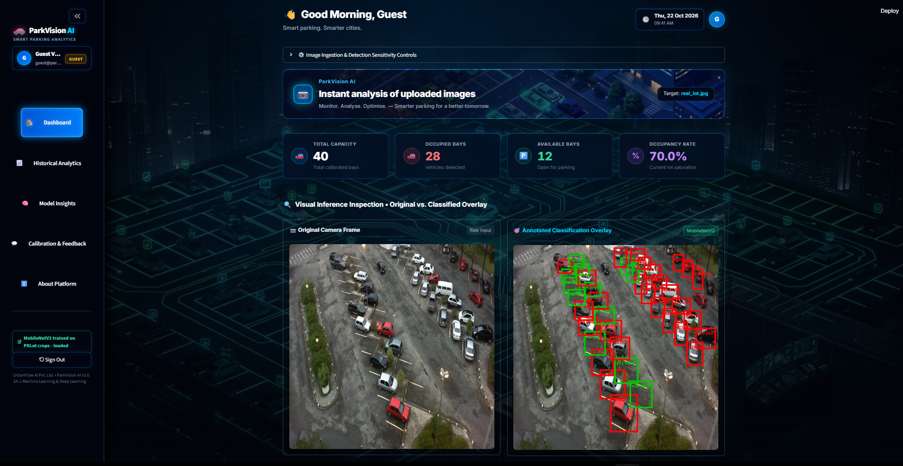
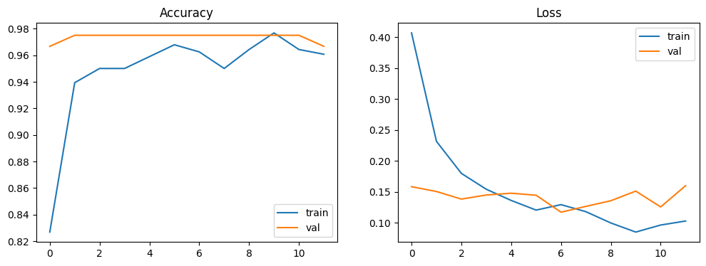
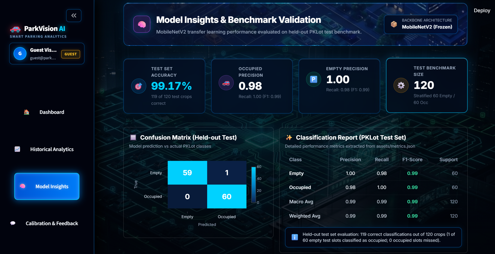
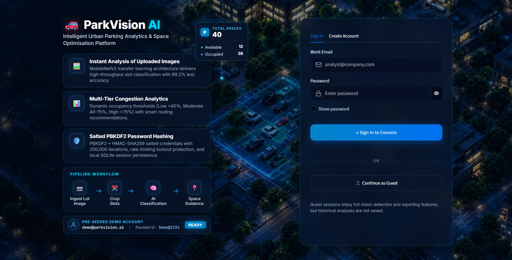
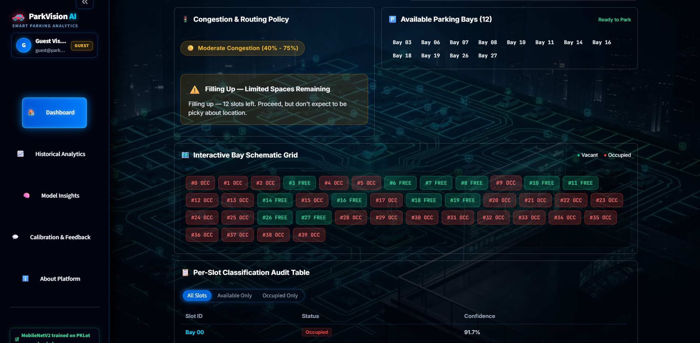

# ParkVision AI — Intelligent Urban Parking Analytics & Space Optimisation Platform

| | |
|---|---|
| **CRS** | Artificial Intelligence |
| **Course** | Machine Learning and Deep Learning |
| **Assessment** | SA-1 (Summative Assessment) — Scenario 1: ParkVision AI |
| **Student name** | Tanmay Kunal Thakur |
| **Candidate registration number** | 1000389 |
| **School name** | Viraj International School |
| **GitHub repository** | https://github.com/tanmaythakur09/IADAI201_1000389-TanmayThakur |
| **Live app (Streamlit Cloud)** | <<STREAMLIT APP URL>> |

> **Quick start for reviewers:** open the live app and click **Continue as Guest** (no sign-up needed). A demo account also exists: `demo@parkvision.ai` / `Demo@1234`.



---

## 1. Project overview

UrbanFlow AI Pvt. Ltd. wants camera-based parking analytics that replace per-slot hardware sensors. ParkVision AI takes a photo of a parking lot and reports, for every slot, whether it is **Occupied** or **Empty**. It turns those slot-level predictions into occupancy %, a congestion level, a list of free bays and a plain-language recommendation, all inside a Streamlit dashboard.

- **Input:** a parking-lot image (fixed camera angle) and the pixel position of each slot (`slot_positions.json`)
- **Output:** per-slot status and confidence, total / occupied / available counts, occupancy %, congestion level (Low / Moderate / High), a recommendation, and CSV / PNG / PDF exports
- **Approach:** crop-based binary **image classification**. Each known slot is cropped and classified by a MobileNetV2 transfer-learning model. This matches how the PKLot dataset is labelled and is simpler and more robust at this scale than full-image object detection.
- **Real-world challenges considered:** shadows and lighting changes, overcast / wet pavement, partial occlusion, and dense lots with overlapping slot boxes (see §8 for what worked and what did not).

## 2. Research background & references

- Shoup, D. — *"Cruising for Parking"*, **Transport Policy**, 2006. A review of 16 studies found that cruising for parking made up 8–74% of traffic in the areas studied, averaging about 30%. This is the motivation for knowing where free spaces are before a driver arrives.
- Almeida, P. et al. — *"PKLot – A robust dataset for parking lot classification"*, **Expert Systems with Applications**, 2015. Source dataset and its Occupied / Empty labelling scheme.
- Sandler, M. et al. — *"MobileNetV2: Inverted Residuals and Linear Bottlenecks"*, **CVPR 2018**. Backbone used via transfer learning.
- [Ultralytics YOLO documentation](https://docs.ultralytics.com/) — consulted as the alternative (object-detection) approach and not used; classification was chosen instead (§1).
- [Streamlit](https://docs.streamlit.io/), [OpenCV](https://docs.opencv.org/), [TensorFlow / Keras](https://www.tensorflow.org/) documentation.

## 3. Data

**Dataset:** PKLot (Kaggle mirror `ammarnassanalhajali/pklot-dataset`, COCO format). Full lot photographs are split into `train` (8,691 images), `valid` (2,483) and `test` (1,242) folders. Annotations label each slot as `space-empty` or `space-occupied`.

**Preparation** (`notebooks/01_data_preprocessing_and_training.ipynb`):

1. Read each split's COCO annotation file and keep the two slot classes (occupied / empty).
2. **Crop** every sampled slot bounding box out of its lot photo.
3. **Balanced sampling** with `random.seed(42)`: 280 crops per class for train, 60 per class for validation, 60 per class for test, i.e. **560 / 120 / 120 crops** (800 in total, a 70% / 15% / 15% split).
4. **Resize** every crop to 224 × 224 (MobileNetV2 input size).
5. Use the dataset's **own** train / valid / test folders for the splits, so no photo contributes crops to more than one split.
6. **Augmentation** (training only): random horizontal flip, small rotation and brightness changes through Keras `Random*` layers, to cope with lighting and weather variation.

The prepared subset is committed in `data/content/data/` (`{train,val,test}/{occupied,empty}/`).

**Caveat:** PKLot frames come from a few fixed cameras, so many frames look alike. Held-out accuracy can therefore be optimistic compared with a completely new camera.

## 4. Model

- **Architecture:** MobileNetV2 (ImageNet weights, `include_top=False`, frozen) → GlobalAveragePooling2D → Dropout 0.3 → Dense 128 (ReLU) → Dropout 0.2 → Dense 1 (sigmoid).
- **Preprocessing:** MobileNetV2's `preprocess_input` is the first layer *inside* the saved model, so the app feeds raw 0–255 RGB pixels.
- **Training:** Adam, binary cross-entropy, batch size 32, up to 25 epochs, early stopping on validation loss (patience 5), best weights restored. Trained in Google Colab (T4 GPU).
- **Label convention:** `empty = 0`, `occupied = 1`.
- **Saved model:** `model/parking_classifier.keras`.



Training stopped after 12 epochs (early stopping, patience 5): validation accuracy plateaued near 97% and validation loss stopped improving after about epoch 7.

## 5. Results (held-out test set: 120 crops)

| Metric | Value |
|---|---|
| **Test accuracy** | **99.17%** (119 / 120 correct) |
| Occupied — precision / recall / F1 | 0.98 / 1.00 / 0.99 |
| Empty — precision / recall / F1 | 1.00 / 0.98 / 0.99 |

Confusion matrix (rows = true, columns = predicted):

| | Pred. empty | Pred. occupied |
|---|---|---|
| **True empty** | 59 | 1 |
| **True occupied** | 0 | 60 |

The raw numbers are stored in `assets/metrics.json` and shown in the app's **Model Insights** page.



## 6. System logic — parking insights

Implemented in `utils/insights.py` and unit-tested:

- **Occupancy %** = occupied slots ÷ total slots × 100
- **Congestion level:** Low (< 40%), Moderate (40–75%), High (> 75%)
- **Recommendation:** generated from the congestion level and the number of free slots (for example *"Plenty of space — 35 slots open"*, *"Filling up — 12 slots left"*, *"Nearly full — only 2 slot(s) left. Consider another lot"*).
- **Decision threshold:** the user can change the probability cut-off for "occupied" (default 0.50) in the dashboard.

## 7. Web application (Streamlit)

| Page | What it does |
|---|---|
| **Login / Sign up / Guest** | Account creation and sign-in. Passwords are salted and hashed (PBKDF2-HMAC-SHA256) in a local SQLite database, with sign-in lockout after repeated failures. Guest mode needs no account and keeps data in the session only. |
| **Dashboard** | Upload a lot photo and slot positions (or use the built-in sample). Shows KPIs, original vs annotated overlay (green = free, red = occupied), congestion label, recommendation, free-bay list, per-slot confidence table and **PNG / PDF / CSV exports**. |
| **Historical Analytics** | Charts and records of the analyses run by the signed-in user. |
| **Model Insights** | Real test metrics, confusion matrix, architecture and evaluation scope. |
| **Calibration & Feedback** | Users rate predictions and list misclassified slots. |
| **About Platform** | Problem statement, inputs / outputs and pipeline. |




### Run locally

```bash
python -m venv venv
venv\Scripts\activate            # Windows (Python 3.12 recommended)
pip install -r requirements.txt
streamlit run app.py
python -m pytest                  # run the unit tests
```

`parkvision.db` is created automatically on first run and is git-ignored.

### Using your own photos

Slot positions are pixel boxes tied to **one fixed camera view**. Create them for a new lot with:

```bash
python slot_position_picker.py --image path/to/lot.jpg --out slot_positions.json
```

Then upload the image and the JSON in the dashboard.

## 8. Testing

### 8.1 Automated tests
`python -m pytest` runs **18 tests, all passing**: authentication (`tests/test_auth.py`) and the congestion / recommendation logic (`tests/test_insights.py`).

### 8.2 Real-photo testing (unseen full lot photos)
Five complete lot photos from the PKLot **test split** were run through the live app. Ground truth comes from the dataset's labels. "Error" is the net difference in occupied-slot count.

| # | Conditions | Slots | True occ / empty | App occ / empty | Congestion (true → app) | Net error |
|---|---|---|---|---|---|---|
| 1 | Overcast, 40-slot lot | 40 | 28 / 12 | 28 / 12 | Moderate → Moderate | 0 |
| 2 | Overcast, wet pavement, dark cars | 40 | 7 / 33 | 5 / 35 | Low → Low | 2 |
| 3 | Overcast / rainy, crowded diagonal lot | 28 | 25 / 3 | 24 / 4 | High → High | 1 |
| 4 | Overcast, dense 100-slot lot | 100 | 91 / 9 | 89 / 11 | High → High | 2 |
| 5 | Wet, low light, nearly full | 40 | 39 / 1 | 38 / 2 | High → High | 1 |
| | **Total** | **248** | | | **5 / 5 labels correct** | **6** |

**Findings**
- All **five congestion labels and recommendations were correct**, even where the count was off by 1–2 slots.
- Across 248 slots the net count error was 6 (about 2.4%), so slot-level accuracy is at most about 97.6%. These are only five photos, so this is a sanity check, not a replacement for the 120-crop test set in §5.
- **Every error was in the same direction:** an occupied slot reported as free. Misses were mostly **dark cars on dark, wet asphalt** and crops where a slanted bay is covered by an axis-aligned box that also catches neighbouring ground.
- The overlay only covers the slots that PKLot labels in each photo, not every car visible (see Photo 4), so occupancy % describes the *calibrated* slots only.

**Problems found while testing and what was changed**
- The first real-photo test showed **every slot as empty**. The cause was MobileNetV2 preprocessing applied twice (once inside the saved model, once in the app). It was removed from the app, and the same photo then matched ground truth (28 occupied / 12 empty).
- Early versions of the dashboard contained placeholder numbers. These were removed so that every figure comes from the uploaded image, the model's saved metrics or the user's own history.
- Guest data was separated from registered users' data, and one user's history and feedback are no longer visible to another.
- The **Decision Threshold** control was added so an operator can make the app more or less sensitive.

## 9. Deployment

Deployed on **Streamlit Community Cloud** (link at the top).

1. Push the repository to GitHub (code, notebook, `model/`, `data/`, `requirements.txt`).
2. On [share.streamlit.io](https://share.streamlit.io), choose the repository, branch `main`, main file `app.py`.
3. In **Advanced settings** choose **Python 3.12**.
4. `requirements.txt` uses `tensorflow-cpu` to stay within the free tier's memory limit.

Notes: Streamlit Cloud's disk is temporary, so the SQLite database resets when the app restarts and accounts created by visitors may disappear. The demo account is re-created automatically and Guest mode always works.

## 10. Limitations and future work

- Slot positions must be defined once per camera view; a moved camera needs recalibration.
- The model was trained on 560 PKLot crops from a few cameras. A new camera, night scenes or heavy snow have not been tested.
- Dark vehicles in rain are the main weakness (see §8). More training data and fine-tuning the last MobileNetV2 layers are the obvious next steps.
- Analysis works on uploaded still images, not live video streams.
- A rotated-box slot definition would remove most overlap between neighbouring slots.

## 11. Repository structure

```
parkvision-ai/
├── app.py                 # Streamlit entry point
├── slot_position_picker.py
├── requirements.txt
├── README.md
├── auth/  db/             # sign-in, hashing, SQLite access
├── ui/  views/            # theme, components and the six pages
├── utils/                 # detection.py, insights.py, export.py
├── tests/                 # 18 pytest tests
├── model/                 # parking_classifier.keras
├── data/                  # train / val / test crop subset
├── test_photos/           # 4 extra unseen photos + slot JSONs used in §8
├── assets/                # metrics.json, sample lot, screenshots, plots
└── notebooks/
    └── 01_data_preprocessing_and_training.ipynb
```
